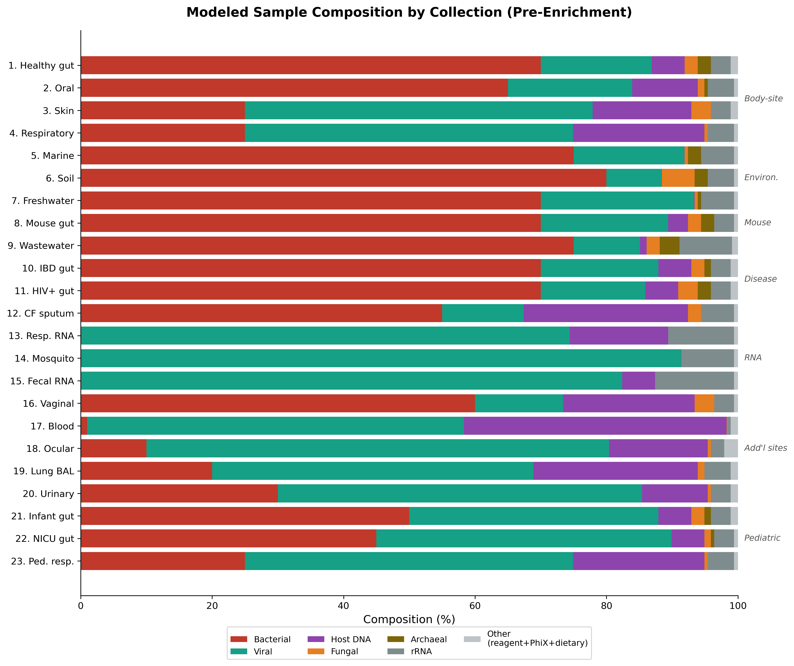
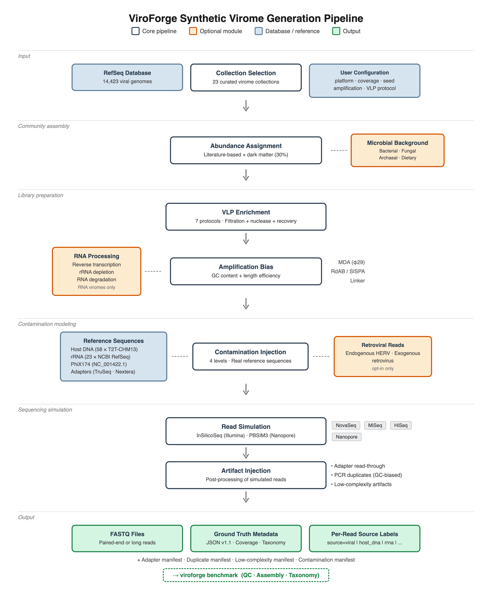
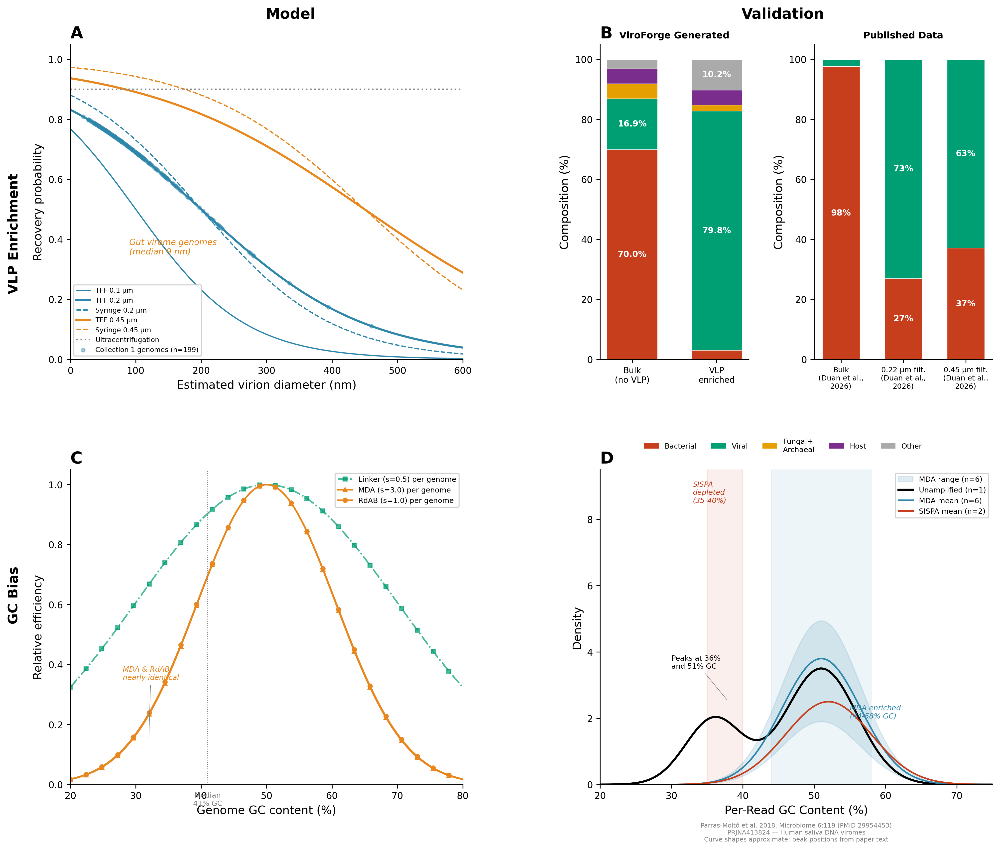
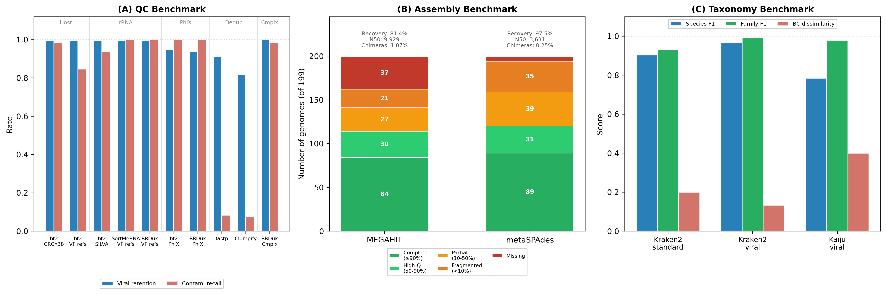

# ViroForge: a comprehensive synthetic virome generator for benchmarking metagenomic analysis pipelines

Leran Wang¹ and Scott A. Handley¹\*

¹Department of Pathology and Immunology, Washington University School of Medicine in St. Louis, St. Louis, MO

\*To whom correspondence should be addressed.

---

## Abstract

**Motivation:** Viral metagenomics (viromics) enables culture-independent characterization of viral communities, yet no standardized benchmark with known ground truth exists for evaluating virome analysis pipelines. Existing metagenomic simulators do not model virome-specific biases, such as VLP enrichment, amplification-induced GC bias, and the mixture of host, ribosomal, microbial, and reagent contaminants, making it impossible to disentangle algorithmic limitations from data-driven artifacts.

**Results:** We present ViroForge, a Python framework that generates synthetic virome FASTQ datasets from 14,423 RefSeq viral genomes organized into 23 curated collections spanning human body sites, environmental habitats, disease states, and pediatric cohorts. ViroForge models the complete virome wet-lab workflow: VLP enrichment (seven protocols, three pore sizes, two efficiency tiers), amplification bias (MDA, RdAB, Linker), real reference contamination (host DNA, rRNA, PhiX, adapters), site-specific microbial background (bacterial, fungal, archaeal, dietary) with per-collection community profiles, and sequencing artifacts across four platforms (NovaSeq, MiSeq, HiSeq, Oxford Nanopore). Every read carries a machine-readable source label enabling exact ground-truth evaluation. An integrated benchmarking framework scores QC, assembly, and taxonomic classification against this ground truth. Validation on a gut virome dataset processed with real-world databases (GRCh38, SILVA, Kraken2, Kaiju) demonstrated that contamination profiles match published experimental ranges and that the benchmarking modules correctly discriminate pipeline performance.

**Availability and Implementation:** ViroForge is freely available at https://github.com/shandley/viroforge under the MIT license. A browser-based web interface (`viroforge web`) provides interactive dataset generation and benchmarking; an interactive pipeline explorer is available at https://shandley.github.io/viroforge/pipeline_explorer. Implemented in Python (≥3.8); compatible with Linux, macOS, and Windows.

### Key Points

- ViroForge is the first virome-specific synthetic data generator that models VLP enrichment, amplification bias, per-collection microbial background, and real reference contamination with per-read ground-truth provenance.
- 23 literature-curated virome collections cover human body sites, environmental habitats, disease states, RNA viromes, and pediatric cohorts with biologically grounded abundance distributions and site-specific contamination profiles.
- An integrated benchmarking framework with three modules (QC, assembly, taxonomy) scores analysis pipelines against embedded ground truth without custom scripting.
- Validation with real-world databases (GRCh38, SILVA 128, Kraken2 standard/viral, Kaiju) demonstrates that simulated datasets produce biologically consistent benchmarking results across QC, assembly, and taxonomy evaluation.

---

## 1 Introduction

Viral metagenomics enables culture-independent characterization of viral communities, collectively termed the virome, from clinical specimens, environmental samples, and engineered systems. Virome studies have revealed extensive diversity in the human gut (Shkoporov et al., 2019), identified pathogenic viruses in outbreak settings (Gardy and Loman, 2018), and demonstrated the ecological role of bacteriophages in microbial community dynamics (Clokie et al., 2011). Computational pipelines for virome analysis, including quality control, assembly, taxonomic classification, and novel virus discovery, have proliferated, yet no community benchmark analogous to CAMI for bacterial metagenomics (Sczyrba et al., 2017) exists for viromes.

Benchmarking virome pipelines is challenging because virome datasets carry biases that bacterial metagenome simulators do not model. VLP enrichment protocols preferentially retain particles by size, density, and nucleic acid content (Thurber et al., 2009), creating protocol-dependent compositional shifts. Sequence-independent amplification methods such as MDA introduce systematic GC bias favoring genomes near 50% GC (Pinard et al., 2006). Raw virome sequencing data is dominated by non-viral sequences, including host DNA, ribosomal RNA, spike-in controls, and reagent contaminants, that quality control tools must remove while retaining true viral reads. Without ground-truth datasets reflecting these biases, developers cannot determine whether poor pipeline performance stems from algorithmic limitations or from artifacts the tool was not designed to handle.

Existing simulation tools address parts of this problem. InSilicoSeq (Gourlé et al., 2019) generates Illumina reads with realistic error profiles; CAMISIM (Fritz et al., 2019) simulates complex microbial communities with controlled abundance distributions; ART (Huang et al., 2012) and PBSIM3 (Ono et al., 2022) provide platform-specific read simulation. However, none of these tools model the virome wet-lab workflow: VLP enrichment, amplification bias, real contamination references, per-read source provenance, or virome-specific benchmarking metrics.

We developed ViroForge to fill this gap. ViroForge generates synthetic virome FASTQ datasets modeling the complete experimental workflow, from genome pool through VLP enrichment, amplification, contamination, and sequencing, producing reads with per-read ground-truth labels. An integrated benchmarking framework scores analysis tools against this ground truth. Here we describe the design and implementation of ViroForge, validate its output against published experimental data, and demonstrate the benchmarking framework on representative pipelines using real-world reference databases.

---

## 2 Materials and Methods

### 2.1 Genome database

ViroForge maintains a curated SQLite database of 14,423 complete viral genomes from NCBI RefSeq. Each genome is mapped to ICTV taxonomy through a multi-stage matching pipeline: exact species-name lookup against the ICTV Master Species List, enhanced fuzzy matching with strain-name normalization (fixing 469 previously unmatched genomes), and NCBI lineage enrichment that resolved 4,577 additional genomes to the class level and 2,102 to the family level. After enrichment, 71.7% of genomes are classified to family and 88.9% to class. The remaining 4,080 genomes with family='Unknown' are predominantly modern bacteriophages that ICTV assigns to a genus but no family (following the 2021 abolition of several phage families), representing correct taxonomy rather than a classification gap.

### 2.2 Virome collections

Genomes are organized into 23 curated virome collections (Fig. 1) representing the diversity of sample types encountered in viromics research. Each collection specifies a biologically grounded set of viral genomes with literature-derived relative abundance distributions, prevalence values, and abundance ranks. Collections span nine human body sites (gut, oral, skin, respiratory, vaginal, blood, ocular, lung, urinary), four environmental habitats (marine, soil, freshwater, wastewater), three disease states (inflammatory bowel disease, HIV+ immunosuppression, cystic fibrosis), three RNA virome contexts (respiratory, arbovirus/mosquito, fecal), mouse gut, and three pediatric cohorts (healthy infant, NICU, pediatric respiratory). Genome selection and abundance profiles for each collection were informed by published virome surveys: human body-site collections draw on site-specific studies (Shkoporov et al., 2019; Pride et al., 2012; Hannigan et al., 2015; Wylie et al., 2014; Moustafa et al., 2017; Doan et al., 2016; Santiago-Rodriguez et al., 2015), environmental collections on large-scale viral ecology surveys (Brum et al., 2015; Trubl et al., 2018; Okazaki et al., 2019; Crits-Christoph et al., 2021), disease-state collections on case-control virome studies (Norman et al., 2015; Handley et al., 2012; Monaco et al., 2016; Lim et al., 2013), and pediatric cohorts on infant virome longitudinal studies (Liang et al., 2020; Garmaeva et al., 2019). Per-collection literature sources are listed in Table S1. A configurable dark matter fraction (default 30%) supplements each collection with unclassified viral genomes (family='Unknown') to simulate the large proportion of reads in real viromes that lack database matches (Paez-Espino et al., 2016).

Each collection carries a genome provenance annotation (isolate, prophage, provirus, endogenous, satellite, or viroid) assigned automatically from genome name patterns and overridable by curation scripts. Provenance appears in the per-read source label (e.g., `viral_prophage`, `viral_provirus`) and in the taxonomy ground truth, enabling benchmarking tools to stratify performance by biological origin.

> **Fig. 1.** Modeled sample composition by collection (pre-enrichment). Stacked horizontal bars show the fractional composition of each of the 23 ViroForge collections based on per-collection contamination profiles. Bacterial background dominates gut, environmental, and oral collections (60–80%), while blood/plasma is host DNA-dominated (40%) and RNA virome collections carry elevated rRNA (8–12%). The viral fraction (teal) is the remainder after all contamination and background sources. VLP enrichment removes ≥98% of the bacterial/fungal/archaeal background.

### 2.3 Wet-lab workflow simulation

ViroForge models the virome experimental workflow as composable transformations applied to the genome pool before read generation (Fig. 2), each introducing biologically grounded biases that shape dataset composition.

**VLP enrichment.** Seven protocols are modeled: tangential flow filtration (TFF; 0.1, 0.2, and 0.45 μm), syringe filtration (0.2 and 0.45 μm), ultracentrifugation (100,000 × g), and column-based extraction (Norgen kit). Each protocol operates at one of two efficiency tiers (*standard* or *high*) controlled by the `--vlp-efficiency` flag, producing 14 distinct configurations (Table S2). Filtration protocols apply size-dependent retention curves derived from published filtration physics (Thurber et al., 2009): virions smaller than the pore size pass through the membrane and are recovered in the filtrate, while cells and debris are blocked, so recovery *decreases* with virion diameter. The sigmoid retention function *R*(*d*) = 1 / (1 + exp(*k*(*d* − *p*))) models this, where *d* is virion diameter (nm), *p* is pore size (nm), and *k* is steepness (Fig. 3A). Virion diameters are estimated from genome length and type using empirical log-linear relationships (Cui et al., 2014) with genome-type-specific coefficients (dsDNA, ssDNA, dsRNA, ssRNA, ssRNA-RT). Ultracentrifugation retains all particle sizes uniformly (recovery rate 0.90); column-based extraction favors larger particles through a binding-capacity model normalized at 80 nm. Technical variation (CV = 5%) is applied to all protocols. Contamination reduction varies by contaminant type: host DNA is primarily removed by nuclease treatment, while bacteria and fungi are removed by filtration with an additional nuclease component acting on the lysed fraction (30% of cells; Thurber et al., 2009).

**Amplification bias.** Three amplification methods are modeled (Fig. 3C; Table S3), plus a no-amplification control. MDA (phi29 polymerase) applies a Gaussian GC efficiency function *e* = exp(−15*s*(*gc* − 0.50)²), where *s* is the GC bias strength parameter (default 3.0), producing a penalty rate of 45 at default settings. This yields a 90-fold dynamic range across the 30–70% GC spectrum. MDA efficiency is further modulated by stochastic log-normal variation (CV = 0.3) and scales with amplification time (default 4 hours, exponent = time/4). Chimera formation rate is 15% by default (Lasken and Stockwell, 2007). Random-priming amplification (RdAB; also termed SISPA) applies both GC and length biases: GC efficiency *e*_gc = exp(−((*gc* − 0.50)/0.15)² × *s*) with default *s* = 1.0, and length bias *e*_len = exp(−0.015 × *length*_kb). Linker amplification (adapter ligation + PCR) uses milder parameters: GC tolerance 0.20 (wider than RdAB's 0.15), *s* = 0.5, and no length bias. All three methods apply GC efficiency as a total relative multiplier; the generator does not compound efficiency over PCR cycles, as `calculate_gc_efficiency()` returns an integrated end-to-end relative efficiency rather than a per-cycle value.

**RNA virome workflow.** RNA viromes require additional library preparation steps. Reverse transcription efficiency varies by virus type: ssRNA+ 70–90%, ssRNA− 50–70%, dsRNA 40–80%, ssRNA-RT 75–85%, with primer-type modifiers (random hexamer 1.0×, random octamer 1.05×, oligo-dT 0.9×, specific 1.1×). Template switching artifacts occur at 2% rate with 5′/3′ truncation at 15%; a length penalty reduces RT efficiency for genomes exceeding 15 kb. rRNA depletion models Ribo-Zero (90–95% removal) and RiboMinus (85–90% removal). RNA degradation accounts for genome fragility and RNase effects during extraction.

**Contamination.** ViroForge maintains per-collection contamination profiles specifying literature-informed default fractions for 11 contaminant types (Table S1). Real reference sequences are bundled for all contaminant categories (Table S4): 58 human genome fragments from T2T-CHM13v2.0 (48 random 10 kb fragments spanning all autosomes and X, plus 10 HERV-containing ~20 kb fragments at known proviral loci on chr 1–8, 11, and 22), 23 rRNA sequences from NCBI RefSeq (bacterial 16S/23S and eukaryotic 18S/28S), the complete PhiX174 genome (NC_001422.1; 5,386 bp), and 11 Illumina adapter sequences (TruSeq and Nextera).

Microbial background is modeled with four domains of site-specific community profiles, each backed by bundled RefSeq reference fragments. The bacterial reference set comprises 134 fragments (~50 kb each, 6.6 Mb total): 119 generic fragments drawn from 40 taxa across 10 community types, plus 15 curated challenge regions containing integrated prophages, CRISPR arrays with phage-derived spacers, and integrative conjugative elements (ICEs). These challenge regions trigger false-positive viral calls in virome pipelines: prophage-host junctions produce chimeric contigs in assemblers, CRISPR spacers introduce viral k-mers into bacterial contigs that confuse taxonomy classifiers, and ICE-encoded integrases and structural proteins are misannotated as viral. Each of the 10 bacterial community types (gut, oral, skin, respiratory, vaginal, urinary, marine, soil, freshwater, wastewater) specifies characteristic genera with measured GC content: gut communities feature *Bacteroides*, *Faecalibacterium*, *Akkermansia*, and *Roseburia* at 48.6% GC; vaginal communities are *Lactobacillus*-, *Gardnerella*-, and *Prevotella*-dominated at 37.7% GC; soil communities include *Streptomyces*, *Bradyrhizobium*, and *Pseudomonas* at 66.0% GC. Seven fungal community profiles provide site-matched mycobiome genera (gut: *Candida*, *Saccharomyces*; skin: *Malassezia*; respiratory: *Aspergillus*, *Candida*), five archaeal profiles cover relevant archaeome genera (gut: *Methanobrevibacter*, *Methanosphaera*; marine: *Nitrosopumilus*; soil: *Nitrososphaera*), and four dietary profiles model diet-type-specific plant virus carriage (western, mediterranean, plant-based, high-fiber) with characteristic genera (*Tobamovirus*, *Tombusvirus*, *Potyvirus*) reflecting that PMMoV (pepper mild mottle virus) is the most abundant RNA virus in human stool globally. Reference sets are built from RefSeq representative genomes at build time by taxon name, so no accessions are stored in the repository; 15 fungal fragments, 15 archaeal fragments, and 4 dietary fragments complete the set.

Per-collection baselines are set by three well-established drivers (Fig. 1; Table S1): host-cell-rich mucosal and tissue samples carry high human DNA (respiratory 20%, skin 15%, blood/plasma 40%) while environmental samples are near host-free (0.05%); low-microbial-biomass samples (blood, ocular, lung) are dominated by reagent contamination (Salter et al., 2014); and viromes carry quantifiable host and rRNA contamination that QC tools must detect (Zolfo et al., 2019). Bacterial background fractions track per-site microbial biomass (Sender et al., 2016; Human Microbiome Project Consortium, 2012): gut, soil, and wastewater are bacteria-dominated (70–80%), while blood and ocular are paucibacterial (1–10%). The bacterial fraction models the sample's own microbiome and is not scaled by contamination level; four contamination levels scale the other fractions: clean (0.25×), realistic (1.0×), heavy (2.5×), and failed (4.0×), enabling QC benchmark titration against increasing non-viral background. RNA-workflow collections (13–15) set bacterial background to zero because microbial signal in RNA libraries is ribosomal, already covered by the rRNA fraction.

Two optional retroviral modules are available: endogenous HERV injection using 55 Dfam consensus sequences, and exogenous Retroviridae injection. Both default to zero rate and require explicit activation via command-line flags.

**Sequencing artifacts.** Four artifact modules inject realistic sequencing noise. Adapter read-through injects a configurable fraction of reads with adapter sequences at the 3′ end, using insert sizes drawn from a normal distribution (default σ = 30 bp) to determine adapter contamination length per read; TruSeq and Nextera adapters are supported. Low-complexity artifacts include four types with configurable weights: poly-G runs (40%, modeling NovaSeq two-color chemistry failures), homopolymer repeats (25%), poly-N mixed sequences (15%), and low-entropy sequences (20%), with configurable Shannon entropy ranges (0.0–2.0 bits) for threshold calibration. PCR duplicate clusters follow a geometric copy distribution (default max_copies = 5, error_rate = 0.001/base) with GC-biased template selection (Gaussian weight centered at 50% GC, σ = 0.15 for PCR methods, σ = 0.10 for MDA) and paired-end consistency.

> **Fig. 2.** ViroForge data generation pipeline. Genomes from a curated collection pass through VLP enrichment, amplification, and contamination stages that introduce virome-specific biases. Real reference sequences are used for all contaminant types. Every output read carries a source label enabling exact ground-truth evaluation by the integrated benchmarking framework.

> **Fig. 3.** ViroForge bias models and validation (2×2 composite). **(A)** VLP enrichment recovery probability as a function of virion diameter for seven protocols. Sigmoid curves at 0.1, 0.2, and 0.45 μm model size-dependent passage through membrane pores; ultracentrifugation (dashed) retains all sizes equally; column-based extraction favors larger particles. **(B)** VLP enrichment validation: ViroForge-simulated gut virome composition (bulk vs. VLP-enriched) compared with published experimental data from stool viromes (Duan et al., 2026). Published values are viral-contig-mapping read fractions (means of triplicates): bulk metagenome 2.37%, 0.22 μm filtration (VP1) 73.0%, and 0.45 μm filtration (VP3) 62.9%. ViroForge's TFF 0.2 μm model produces 79.8% viral reads, within the range of published 0.2–0.45 μm filtration-based VLP protocols. **(C)** Amplification GC bias: relative efficiency as a function of genome GC content for MDA (phi29; strength 3.0), RdAB (strength 1.0), and Linker (strength 0.5). Note that MDA and RdAB curves largely overlap at their default parameters (e.g., relative efficiency 0.37 vs. 0.37 at 35% GC), reflecting the similar bias profiles of phi29- and random-priming-based amplification; the two are distinguished primarily by RdAB's additional length-dependent bias (not shown). **(D)** GC bias validation: per-read GC content density distributions from unamplified, MDA-amplified (n=6), and SISPA-amplified (n=2) human saliva viromes (Parras-Moltó et al., 2018; PRJNA413824), demonstrating amplification-induced GC range narrowing.

### 2.4 Per-read ground truth

Every read carries a machine-readable `source=` tag in its FASTQ header identifying its biological origin. ViroForge assigns 19 distinct source labels organized into three tiers:

**Core labels** (assigned by the default pipeline): `viral` (standard isolate viral genomes), `dark_matter` (unclassified viral genomes with family='Unknown'), `host_dna` (human genome fragments from T2T-CHM13), `host_dna_herv` (HERV-containing host genome fragments), `rrna` (rRNA contamination sequences), `phix` (PhiX174 spike-in control), `reagent_bacteria` (reagent/kit contamination), `bacterial_background` (bulk metagenome bacteria), `fungal_background` (mycobiome), `archaeal_background` (archaeome).

**Provenance-based viral subtypes** (auto-detected from genome name patterns or set by curation scripts): `viral_prophage`, `viral_provirus`, `viral_endogenous`, `viral_satellite`, and `viral_viroid`. Genomes not matching any provenance pattern receive the default `viral` label.

**Opt-in labels** (require explicit command-line flags): `dietary_background` (`--diet`), `erv_endogenous` (`--erv-endogenous-rate`), `erv_exogenous` (`--erv-exogenous-rate`), and `artifact_low_complexity` (`--low-complexity-rate`).

Per-read provenance enables exact QC metric computation without the circularity of evaluating one pipeline's output against another's prediction. Artifact reads (adapter read-through, PCR duplicates) retain the source label of their template genome; manifest TSV files record all affected read names.

### 2.5 Sequencing platforms

ViroForge supports four sequencing platforms: Illumina NovaSeq 6000, MiSeq, and HiSeq 2500 via InSilicoSeq (Gourlé et al., 2019), and Oxford Nanopore via PBSIM3 (Ono et al., 2022). Matched hybrid assembly datasets combining short-read and long-read data from the same genome pool are generated with a single command.

### 2.6 Benchmarking framework

ViroForge includes a three-module benchmarking framework accessible via `viroforge benchmark`:

**Module 1: QC.** Compares cleaned reads against raw reads using per-read source labels. For each processing step (host removal, rRNA removal, PhiX removal, deduplication, complexity filtering), users specify a keep/remove policy defining which source labels should be retained and which removed. Reports viral retention rate, per-contaminant-type removal rates, and aggregate precision/recall/F1. A read-name match-rate gate warns when cleaned reads cannot be mapped back to raw reads. Duplicate removal is scored separately using duplicate manifest files.

**Module 2: Assembly.** Aligns contigs to true genomes using minimap2 (via the mappy Python binding). Reports genome recovery rate, per-genome completeness and identity, chimeric contig detection, N50/L50, completeness categorization (complete ≥90%, high-quality ≥50%, partial ≥10%, fragmented >0%, missing 0%), and abundance accuracy (Spearman correlation, mean absolute error between true and assembled relative abundances).

**Module 4: Taxonomy.** Evaluates taxonomic classification at taxid-exact, genus, and family levels using an NCBI taxdump lineage tree. Known viruses and dark matter genomes are scored separately. Reports per-rank recall, precision, and F1, abundance profile accuracy (Bray-Curtis dissimilarity, Pearson and Spearman correlations), and known/dark-matter stratification. Built-in parsers for Kraken2, Centrifuge, DIAMOND, MMseqs2, Kaiju, and generic TSV with format auto-detection.

### 2.7 Implementation

ViroForge is implemented in Python (≥3.8) with ~21,000 lines of application code across 51 modules, ~23,000 lines of curation and utility scripts (62 scripts), and 431 test functions spanning ~8,200 lines of test code. The CLI provides ten subcommands: `browse`, `generate`, `batch`, `report`, `compare`, `presets`, `web`, `setup-db`, `summary`, and `benchmark`. All random operations use seeded RNG instances for full reproducibility.

Each `generate` run produces a self-contained HTML diagnostic report: rank-abundance curves, genome size versus abundance scatter plots, expected coverage distributions, and pre/post VLP composition charts. Reports can be regenerated for existing datasets via `viroforge report --format html`. Each `benchmark` run likewise produces HTML alongside JSON and markdown: contamination removal bar charts and confusion matrices (QC), genome recovery distributions and completeness scatter plots (assembly), per-rank precision/recall/F1 and known-versus-dark-matter breakdowns (taxonomy).

A browser-based web interface (`viroforge web`), built on Flask, exposes the full generation and benchmarking workflow through an interactive GUI: collection browsing, preset or custom dataset generation, batch configurations, diagnostic reports, dataset comparison, and all three benchmarking modules with visual results displayed directly in the browser.

---

## 3 Results

### 3.1 Contamination profile validation

Without VLP enrichment (`--no-vlp`), the gut virome dataset (Collection 1) produced 71.8% bacterial, 4.1% viral, 2.5% fungal+archaeal, and 5.0% host DNA reads, consistent with the 2.37% viral fraction measured in bulk stool metagenomes (Duan et al., 2026). VLP enrichment via tangential flow filtration (0.2 μm) reduced bacterial background by ≥98%, producing ≥80% viral reads, within the range of published filtration protocols (62.9–73.0% viral; Duan et al., 2026). Blood/plasma virome (Collection 17) produced 40% host DNA, reflecting cell-free DNA dominance, with only 1% bacterial background; CF respiratory virome (Collection 12) produced 25% host DNA and 55% bacterial background, reflecting neutrophil DNA and chronic infection. Environmental collections (marine, soil, freshwater) carry near-zero host DNA (0.05%) but high bacterial background (70–80%), with soil showing the highest fungal (5%) and archaeal (2%) fractions (Fig. 1).

### 3.2 GC bias modeling

MDA-amplified datasets showed preferential amplification of genomes near 50% GC content (Fig. 3C), with relative efficiency of 1.0 at 50% GC declining to 0.011 at 30% GC under default gc_bias_strength=3.0. The penalty rate of 15.0 × gc_bias_strength × (*gc* − 0.50)² produces a 90-fold dynamic range across the 30–70% GC range, consistent with published phi29 measurements demonstrating systematic GC-dependent amplification bias (Pinard et al., 2006; Yilmaz et al., 2010). The MDA GC optimum of 50% was calibrated against saliva virome data showing over-amplification in the 45–60% GC band (Parras-Moltó et al., 2018). RdAB (gc_bias_strength=1.0, gc_tolerance=0.15) combines moderate GC bias with length-dependent exponential decay (0.015/kb), introducing a joint bias that no other method models. Linker amplification (gc_bias_strength=0.5, gc_tolerance=0.20) maintained >0.5 efficiency across 35–65% GC, reflecting modern adapter-ligation library prep kits. All three methods apply GC efficiency as a total relative multiplier without cycle compounding, as the efficiency functions return integrated end-to-end relative values.

### 3.3 VLP enrichment modeling

Filtration-based protocols at 0.2 μm yield sigmoid retention curves centered at 200 nm (Fig. 3A) with protocol-specific steepness (TFF: *k*=0.008; syringe: *k*=0.010). At 0.45 μm, the transition shifts to 450 nm, retaining most tailed phages (60–200 nm) with reduced steepness (TFF 0.45: *k*=0.006; syringe 0.45: *k*=0.008). TFF at 0.1 μm (*k*=0.012) provides the tightest filtration, achieving the highest contamination reduction (0.85 standard / 0.92 high) but lower recovery (0.75) as larger viruses may be excluded. Ultracentrifugation retains all sizes equally (recovery 0.90) but achieves lower contamination reduction (0.62 standard / 0.68 high). Two efficiency levels ('standard' and 'high') model the range from typical VLP preparations to optimized protocols (Table S2). These profiles match published VLP enrichment results from stool viromes: 0.22 μm filtration yields 73.0% and 0.45 μm filtration yields 62.9% viral reads (Duan et al., 2026), compared with ViroForge's 79.8% for TFF 0.2 μm (Fig. 3B).

### 3.4 Benchmarking framework validation

We validated the benchmarking framework by generating a gut virome dataset (Collection 1, NovaSeq, 10× coverage, seed 42) and processing it through standard analysis pipelines using real-world reference databases. The QC benchmark evaluated ten tool/database combinations across five processing steps; the assembly benchmark compared MEGAHIT and metaSPAdes; the taxonomy benchmark evaluated Kraken2 (standard and viral databases) and Kaiju (viral database). Tables 1a–1c and Figure 4 summarize the results.

**QC module.** Host DNA removal was evaluated with Bowtie2 against two references: the full GRCh38 human genome (~3.1 Gb) and ViroForge's bundled host fragments (58 sequences, ~680 kb). Bowtie2+GRCh38 achieved 99.4% viral retention with 98.4% contaminant recall (F1 = 0.74); bundled references achieved 99.6% viral retention with 84.6% recall (F1 = 0.74). GRCh38's higher recall reflects its comprehensive genome coverage, though both achieved comparable F1.

For rRNA removal, Bowtie2+SILVA_128 (~12 GB index) achieved 93.6% recall (F1 = 0.74); SortMeRNA with ViroForge's bundled 23-sequence rRNA references achieved 100% recall with 99.5% viral retention (F1 = 0.78); BBDuk with ViroForge references achieved 100% recall with 99.5% viral retention (F1 = 0.79). Bundled references achieved higher recall because they are the same sequences used in dataset generation; SILVA's lower recall reflects alignment ambiguity in its comprehensive database.

PhiX removal via Bowtie2 achieved 100% recall but only 1.3% precision and 94.8% viral retention; BBDuk achieved 100% recall with 1.1% precision and 93.6% viral retention. The unexpectedly high viral read loss is analyzed in Section 3.5. Deduplication showed the expected trade-off: fastp detected 8.3% of duplicates with 91.1% viral retention; Clumpify detected 7.4% with 81.8% retention. Both tools' low F1 (0.09–0.12) reflects the fundamental difficulty of distinguishing true PCR duplicates from biologically identical reads. Low-complexity filtering via BBDuk achieved near-perfect performance (98.3% recall, 99.6% precision, F1 = 0.99).

**Assembly module.** MEGAHIT produced 1,877 contigs with N50 = 9,929, recovering 81.4% of genomes (162/199) with 84 complete (≥90% completeness), 30 high-quality, 27 partial, 21 fragmented, and 37 missing. metaSPAdes produced 7,128 contigs with N50 = 3,631, recovering 97.5% of genomes (194/199) with 89 complete, 31 high-quality, 39 partial, 35 fragmented, and 5 missing. Chimera rates were low: MEGAHIT 1.07% (20/1,877), metaSPAdes 0.25% (18/7,128). Abundance estimation was accurate for both assemblers: Spearman correlation 0.913 with mean absolute error 0.001 (Table 1b).

**Taxonomy module.** Kraken2 with the standard database achieved 82.6% sensitivity for known viruses with species-level F1 of 0.90, family-level F1 of 0.93, and Bray-Curtis dissimilarity of 0.198. Kraken2 with a viral-specific database achieved substantially higher sensitivity (92.4%) with species F1 of 0.97, family F1 of 0.99, and lower Bray-Curtis dissimilarity (0.131), demonstrating the expected benefit of a targeted reference for virome analysis.

Kaiju (protein-level classification, viral database) achieved 63.2% sensitivity on known viruses (n=328,474) with lower species-level F1 (0.78) but high family-level F1 (0.98), reflecting the strength of protein-level classification for higher-rank assignments. Kaiju's dark matter sensitivity was 49.2% (n=154,927 dark matter reads), indicating that nearly half of unclassified viral genomes share sufficient protein-level similarity with known references for detection. Abundance profile accuracy was moderate (Pearson 0.642, Spearman 0.670, Bray-Curtis dissimilarity 0.398), reflecting Kaiju's lower per-read sensitivity compared to k-mer methods (Table 1c).

> **Table 1.** Benchmarking metrics for the gut virome (Collection 1, NovaSeq, 10× coverage, seed 42). QC metrics report viral retention, contaminant recall, precision, and F1 for each tool/database combination. Assembly metrics from MEGAHIT and metaSPAdes. Taxonomy metrics from Kraken2 (standard and viral databases) and Kaiju (viral database).

**Table 1a. QC benchmark results**

| Step | Tool | Database | Viral Ret. | Recall | Precision | F1 |
|------|------|----------|-----------|--------|-----------|-----|
| Host removal | Bowtie2 | GRCh38 | 0.994 | 0.984 | 0.596 | 0.743 |
| Host removal | Bowtie2 | ViroForge refs | 0.996 | 0.846 | 0.655 | 0.738 |
| rRNA removal | Bowtie2 | SILVA_128 | 0.995 | 0.936 | 0.615 | 0.743 |
| rRNA removal | SortMeRNA | ViroForge refs | 0.995 | 1.000 | 0.633 | 0.776 |
| rRNA removal | BBDuk | ViroForge refs | 0.995 | 1.000 | 0.650 | 0.788 |
| PhiX removal | Bowtie2 | NC_001422.1 | 0.948 | 1.000 | 0.013 | 0.025 |
| PhiX removal | BBDuk | PhiX ref | 0.936 | 1.000 | 0.011 | 0.021 |
| Deduplication | fastp | — | 0.911 | 0.083 | 0.216 | 0.120 |
| Deduplication | Clumpify | — | 0.818 | 0.074 | 0.108 | 0.088 |
| Complexity | BBDuk | — | 1.000 | 0.983 | 0.996 | 0.989 |

**Table 1b. Assembly benchmark results**

| Assembler | Contigs | N50 | L50 | Recovery | Complete | High-Q | Partial | Frag. | Missing | Chimeras | Spearman | MAE |
|-----------|---------|------|-----|----------|----------|--------|---------|-------|---------|----------|----------|-----|
| MEGAHIT | 1,877 | 9,929 | 123 | 81.4% (162/199) | 84 | 30 | 27 | 21 | 37 | 20 (1.07%) | 0.913 | 0.001 |
| metaSPAdes | 7,128 | 3,631 | 274 | 97.5% (194/199) | 89 | 31 | 39 | 35 | 5 | 18 (0.25%) | 0.913 | 0.001 |

**Table 1c. Taxonomy benchmark results**

| Classifier | Database | Known Sens. | Known Prec. | Species F1 | Genus F1 | Family F1 | BC Dissim. |
|------------|----------|-------------|-------------|------------|----------|-----------|------------|
| Kraken2 | Standard | 0.826 | 0.826 | 0.903 | 0.928 | 0.931 | 0.198 |
| Kraken2 | Viral | 0.924 | 0.929 | 0.966 | 0.992 | 0.994 | 0.131 |
| Kaiju | Viral | 0.632 | 0.659 | 0.784 | 0.945 | 0.979 | 0.398 |

> **Fig. 4.** Benchmarking framework validation on gut virome (Collection 1, NovaSeq, 10× coverage). **(A)** QC benchmark: viral retention rate and contaminant recall across ten tool/database combinations in five processing steps (host removal, rRNA removal, PhiX removal, deduplication, complexity filtering). Real-world databases (GRCh38, SILVA_128) are compared alongside ViroForge bundled references. **(B)** Assembly benchmark: genome recovery rate and completeness categories from MEGAHIT and metaSPAdes. **(C)** Taxonomy benchmark: family-level F1 and Bray-Curtis dissimilarity for Kraken2 (standard and viral databases) and Kaiju (viral database).

### 3.5 Per-read source label analysis of QC errors

We traced every false positive (reads incorrectly removed) and false negative (reads incorrectly retained) in the QC benchmark back to its ground-truth source label and genome of origin (Table 3).

**Host removal.** Bowtie2+GRCh38 removed 98.4% of host DNA reads, but 98.3% of its 1,586 false positives were rRNA reads (source=rrna), not viral reads. Human rRNA gene clusters reside within GRCh38, so rRNA reads align to host and are removed during the host step, silently performing rRNA depletion, inflating apparent performance, and reducing rRNA available for the subsequent dedicated removal step. This cross-removal is invisible without source labels. The 143 false negatives were standard host DNA fragments, not HERV-containing regions. HERV-containing fragments (source=host_dna_herv) were removed at 99.9% efficiency (1,116/1,117), slightly exceeding the 97.7% rate for standard host fragments, confirming that endogenous retroviral loci are well-represented in GRCh38.

**rRNA removal.** Bowtie2+SILVA_128 produced 887 false positives, 94.0% bacterial background reads (source=bacterial_background): bacterial genomes carry rRNA operons (16S/23S), so reads spanning these operons align to SILVA and are classified as rRNA contamination. The remaining 6.0% (53 reads) were viral reads from filamentous *Enterobacteria* phages f1 and M13 (Inoviridae, ~6.4 kb) that integrate into *E. coli* genomes near rRNA loci. The 464 false negatives reflect alignment ambiguity: SILVA contains multiple closely related rRNA variants, and some ViroForge rRNA reads align below threshold to the best match.

**PhiX removal.** The dominant false-positive source is *Escherichia* phage phiX174 reads labeled source=viral. BBDuk's k-mer approach produced 24.7% more false positives than Bowtie2 alignment (46,023 vs. 36,916) and uniquely removed reads from Coliphage ID32 (GCF_002618945.1, Microviridae, 6,071 bp), a related but distinct Microviridae member with sufficient k-mer similarity to PhiX174. K-mer tools thus extend collateral damage beyond the target genome to related viral families.

**HERV fragments across non-host steps.** The 1,117 HERV-containing host reads were not removed by any non-host QC step: 0 by rRNA removal (SILVA), 0 by PhiX removal (Bowtie2 or BBDuk), and 1 by complexity filtering. Despite containing retroviral open reading frames, these sequences show no cross-reactivity with rRNA, PhiX, or low-complexity filters, confirming correct handling when each step targets its intended contaminant type.

**Complexity filtering.** BBDuk achieved 98.3% recall with 430 false positives out of 745,150 reads (0.06% false-positive rate). False positives were distributed across viral (61.2%), dark matter (18.8%), and bacterial background (17.0%) reads containing naturally occurring low-complexity subsequences, specifically homopolymer runs and simple repeats below the entropy threshold. CrAssphage cr115_1 (99.8 kb, Suoliviridae) contributed the most viral false positives, consistent with its AT-rich genomic regions. The near-zero false-positive rate confirms that entropy-based complexity filtering is safe for virome datasets.

> **Table 3.** Per-read source label analysis of QC benchmark false positives and false negatives. Each cell shows the count and dominant source label for incorrectly classified reads.

| Step | Tool | FP Count | FP Dominant Source | FN Count | FN Dominant Source |
|------|------|----------|-------------------|----------|-------------------|
| Host removal | Bowtie2+GRCh38 | 1,586 | rRNA (98.3%) | 143 | host_dna (99.3%) |
| rRNA removal | Bowtie2+SILVA | 887 | bacterial_background (94.0%) | 464 | rrna (100%) |
| PhiX removal | Bowtie2 | 36,916 | viral/Microviridae (100%) | 1 | phix (100%) |
| PhiX removal | BBDuk | 46,023 | viral/Microviridae (100%) | 1 | phix (100%) |
| Complexity | BBDuk | 430 | viral (61.2%) | 0 | — |

### 3.6 Assembly ground-truth analysis

We traced every chimeric contig and missing genome in the MEGAHIT and metaSPAdes benchmarks back to its ground-truth genome of origin, family, size, and GC content (Table 4).

**Chimera classification.** Chimeras were classified by the domain of their constituent segments: viral-viral, bacterial-bacterial, or viral-bacterial. MEGAHIT produced 20 chimeras (3 viral-viral, 7 bacterial-bacterial, 0 viral-bacterial, 10 dark matter/unclassified); metaSPAdes produced 18 (0 viral-viral, 10 bacterial-bacterial, 0 viral-bacterial, 8 dark matter/unclassified). Neither assembler produced viral-bacterial chimeras despite the dataset including 15 curated bacterial challenge regions containing integrated prophages, CRISPR arrays with phage-derived spacers, and ICEs, sequences that create ambiguous viral-bacterial boundaries. At 10× coverage, the challenge regions confound classification without corrupting assembly graph resolution.

**Viral chimeras are family-specific.** All three MEGAHIT viral chimeras occurred between closely related Microviridae coliphages (ID32 + WA45, ID32 + NC35, NC35 + WA45), all small (~5–6 kb) ssDNA phages with high sequence similarity whose shared k-mers cause MEGAHIT's de Bruijn graph to merge paths. metaSPAdes avoided all viral chimeras, likely because its multi-k-mer iterative approach resolves the shared regions that trap single-k assembly. This distinction is relevant for gut virome analysis, where Microviridae are among the most abundant phage families.

**Bacterial chimeras reflect conserved regions.** All bacterial-bacterial chimeras (7 MEGAHIT, 10 metaSPAdes) occurred between generic background fragments drawn from 40 taxa. Conserved regions (16S rRNA operons, housekeeping genes) provide shared sequence that produces chimeric contigs, an expected consequence of short-read assembly, not an assembler failure.

**Missing genome patterns.** MEGAHIT missed 37 genomes versus metaSPAdes' 5, a 7.4-fold difference revealing systematic assembly gaps. Among MEGAHIT's missing genomes, 73% (27/37) exceeded 50 kb, predominantly crAss-like phages from Suoliviridae (7), Steigviridae (7), and Intestiviridae (5) at 89–103 kb; 49% (18/37) had GC content below 35%, indicating a joint size-GC bias at 10× coverage. The remaining 10 were dark matter genomes with near-zero abundance generating insufficient reads. metaSPAdes' 5 missing genomes comprised 2 small Microviridae (~4.5–5.6 kb, insufficient complexity for graph resolution) and 3 large low-abundance genomes, recovering the crAss-like phages that MEGAHIT systematically misses. For gut virome studies where crAssphage and related taxa are ecologically dominant, this assembler-specific gap has practical consequences.

> **Table 4.** Assembly chimera classification and missing genome analysis by ground-truth genome properties.

| Metric | MEGAHIT | metaSPAdes |
|--------|---------|------------|
| **Chimeras** | | |
| Total chimeric contigs | 20 (1.07%) | 18 (0.25%) |
| Viral-viral | 3 | 0 |
| Bacterial-bacterial | 7 | 10 |
| Viral-bacterial | 0 | 0 |
| Other (dark matter/unclassified) | 10 | 8 |
| **Missing genomes** | | |
| Total missing | 37 | 5 |
| >50 kb | 27 (73%) | 3 (60%) |
| GC <35% | 18 (49%) | 1 (20%) |
| crAss-like families | 19 (51%) | 0 (0%) |
| Dark matter (abundance ≈0) | 10 (27%) | 0 (0%) |

### 3.7 Taxonomy ground-truth analysis

Source label tracing reveals how non-viral reads interact with viral classification databases and exposes genome-specific blind spots (Table 5).

**Kraken2 standard database classifies non-viral reads to non-viral taxa.** Kraken2 standard classified >99.9% of bacterial background, 99.5% of host DNA, 97.6% of rRNA, and >99.9% of viral reads, but this high classification rate reflects database breadth, not viral specificity. All 149,642 classified bacterial reads mapped to bacterial taxa and all 6,029 host reads to human taxa: correct but irrelevant for virome analysis. Only 3.1% of fungal and 1.6% of reagent bacteria reads were classified, indicating gaps in fungal and environmental coverage.

**Viral-only databases produce false positives from prophage k-mers in bacterial genomes.** Kraken2 viral classified 8,193 bacterial background reads (5.5%) as viral; Kaiju classified 7,241 (4.8%). Per-fragment analysis showed these false positives concentrated in specific fragments: bacterial_bg_gut_0052 at 21.4% and bacterial_bg_gut_0059 at 12.2%, both containing prophage remnants whose k-mer or protein sequences match viral database entries. The 15 curated challenge regions (prophages, CRISPR arrays, ICEs) produced a 1.1% false-positive rate versus 1.5% for generic bacterial fragments, indicating that naturally distributed prophage remnants contribute more false positives in aggregate than the deliberately challenging sequences. In a gut virome where bacterial background constitutes 70% of pre-VLP reads, this translates to thousands of misclassified reads per dataset.

**Newly deposited genomes escape viral database detection.** Kraken2 viral left 5,762 viral reads unclassified (4,827 source=viral, 935 source=dark_matter), concentrated on four genomes deposited in RefSeq after the database build: Aeromonas phage pAEv1818 (GCF_021497855.1, Unknown, 40.8 kb), Psittacine adenovirus 1 (GCF_006425375.1, Adenoviridae, 38.7 kb), Rajidapivirus A1 (GCF_018583415.1, Picornaviridae, 7.9 kb), and Wufeng tupavirus (GCF_029886255.1, Rhabdoviridae, 11.8 kb). This database-vintage effect produces systematic false negatives for recently characterized viruses, a known limitation that per-read provenance makes precisely quantifiable.

**Protein-level classification avoids non-coding false positives.** Kaiju classified zero rRNA and zero reagent bacteria reads, compared to Kraken2 viral's 132 rRNA and 15 reagent reads, because rRNA and reagent sequences share conserved nucleotide k-mers with some viral genomes but lack protein-level homology. However, Kaiju still classified 7,241 bacterial reads as viral, representing genuine prophage-encoded proteins and confirming that these false positives reflect biological homology rather than k-mer artifacts.

**Filamentous phages show inherent taxonomic ambiguity.** Ralstonia phage Rs551 (GCF_002610105.1, Inoviridae) was classified to 2–3 different species-level taxids across all three tools. Filamentous phages integrate into host genomes and undergo frequent horizontal gene transfer, producing mosaic genomes that defy species-level assignment, a biological property no classifier can resolve.

> **Table 5.** Taxonomy classification analysis by source label and classifier.

| Source Label | Kraken2 Std | Kraken2 Viral | Kaiju Viral |
|-------------|-------------|---------------|-------------|
| viral | 400,129/400,191 (>99.9%) | 395,364/400,191 (98.8%) | 384,107/400,191 (96.0%) |
| dark_matter | 173,979/174,032 (>99.9%) | 173,097/174,032 (99.5%) | 168,685/174,032 (96.9%) |
| bacterial_background | 149,642/149,675 (>99.9%) | 8,193/149,675 (5.5%) | 7,241/149,675 (4.8%) |
| host_dna | 6,029/6,060 (99.5%) | 268/6,060 (4.4%) | 87/6,060 (1.4%) |
| rrna | 7,022/7,196 (97.6%) | 132/7,196 (1.8%) | 0/7,196 (0.0%) |
| phix | 519/520 (99.8%) | 519/520 (99.8%) | 519/520 (99.8%) |
| reagent_bacteria | 15/930 (1.6%) | 15/930 (1.6%) | 0/930 (0.0%) |
| fungal_background | 77/2,456 (3.1%) | 46/2,456 (1.9%) | 16/2,456 (0.7%) |

### 3.8 Comparison to existing tools

> **Table 6.** Feature comparison of ViroForge with existing metagenomic simulation tools.

| Feature | ViroForge | InSilicoSeq | CAMISIM | ART | PBSIM3 |
|---------|-----------|-------------|---------|-----|--------|
| Curated virome collections | 23 | — | — | — | — |
| VLP enrichment modeling | 7 protocols | — | — | — | — |
| Amplification GC bias | MDA, RdAB, Linker | — | — | — | — |
| Per-collection microbial background | 4 domains | — | Community profiles | — | — |
| Real contamination references | Host, rRNA, PhiX, adapters | — | — | — | — |
| Per-read source labels | 19 categories | — | Genome of origin | — | — |
| RNA virome workflow | RT, rRNA depletion, degradation | — | — | — | — |
| Sequencing artifacts | Adapters, duplicates, low-complexity | — | — | — | — |
| Illumina platforms | NovaSeq, MiSeq, HiSeq | NovaSeq, MiSeq, HiSeq | Illumina (via ART/ISS) | Multiple Illumina | — |
| Long-read platforms | Oxford Nanopore | — | PacBio (via PBSIM) | — | PacBio, ONT |
| Hybrid assembly | Matched short + long | — | — | — | — |
| Integrated benchmarking | QC, assembly, taxonomy | — | — | — | — |
| Reproducible (seeded RNG) | Yes | Yes | Yes | Yes | Yes |

ViroForge is complementary to these tools: it uses InSilicoSeq and PBSIM3 as read simulation backends and adds the virome biology layer (enrichment, amplification, contamination, and benchmarking) on top of their sequencing simulation.

### 3.9 Dataset reproducibility

ViroForge datasets are fully reproducible: identical parameters and random seed produce identical FASTQ output. All random operations use local `numpy.random.Generator` or `random.Random` instances seeded from the user-specified seed, avoiding global state interference.

---

## 4 Discussion

ViroForge addresses the absence of a virome-specific benchmarking standard by generating synthetic datasets that capture the experimental biases unique to viral metagenomics. Three design decisions distinguish it from existing simulators. First, wet-lab workflow simulation, from VLP enrichment through amplification bias to per-collection contamination with site-specific microbial communities, produces datasets whose composition reflects what virome researchers observe: a gut virome (70% bacterial, gut-community genera) differs fundamentally from a blood virome (1% bacterial, 40% host DNA) or a soil virome (80% bacterial, soil-community genera). Second, per-read source labels from 19 categories provide objective ground truth eliminating circular dependency. Third, the integrated benchmarking framework enables pipeline evaluation without custom scoring scripts.

The multi-domain contamination system enables systematic investigation of QC and assembly pipeline performance. Each collection carries a site-specific profile spanning bacterial, fungal, archaeal, and dietary background alongside host DNA, rRNA, and reagent contamination. Four contamination levels (clean 0.25×, realistic 1.0×, heavy 2.5×, failed 4.0×) scale prep-quality-dependent fractions while preserving sample-intrinsic microbial background, enabling titration of QC performance against increasing non-viral load. Site-specific community profiles (ten bacterial, seven fungal, five archaeal, four dietary) ensure biologically appropriate GC content and taxonomic composition per sample type (gut *Bacteroides* at 48.6% GC vs. soil *Streptomyces* at 66.0% GC). The 15 curated bacterial challenge regions (prophages, CRISPR arrays, ICEs) deliberately confound virome pipelines: assemblers produce chimeric contigs at prophage-host junctions, taxonomy classifiers encounter viral k-mers from CRISPR spacers, and ICE-encoded integrases trigger false-positive viral annotations, enabling benchmarking not just of obvious non-viral contaminant handling but of the biologically ambiguous boundary between viral and bacterial sequences.

The amplification bias models merit attention. MDA produces a 90-fold dynamic range between 50% and 30% GC at default parameters, consistent with systematic GC-dependent bias reported empirically (Yilmaz et al., 2010); the optimum at 50% GC was calibrated to saliva virome data showing over-amplification in the 45–60% GC band (Parras-Moltó et al., 2018). RdAB combines GC bias (gc_bias_strength=1.0, tolerance 0.15) with exponential length decay (0.015/kb), modeling the joint bias of random-priming PCR. Linker amplification (gc_bias_strength=0.5, tolerance 0.20) produces the mildest bias, reflecting modern adapter-ligation kits. All three methods apply efficiency as a single-pass multiplier; the functions return total relative values calibrated to literature-reported end-to-end dynamic ranges, avoiding the per-cycle compounding that would inflate bias exponentially.

The 23 curated collections cover the major sample types in viromics research. The pediatric cohorts (Collections 21–23) address a gap: the developing infant virome differs substantially from adult viromes in its predominance of eukaryotic viruses and pioneer bacteriophages (Liang et al., 2020), yet no benchmark datasets existed for this sample type.

The per-read source label analyses (Sections 3.5–3.7) demonstrate cross-step and cross-tool insights that per-read provenance uniquely enables and that aggregate metrics cannot capture.

A recurring theme is that contaminant categories are not orthogonal. Host removal silently depletes rRNA because human rRNA gene clusters reside in GRCh38; rRNA removal silently depletes bacterial background because bacterial genomes carry rRNA operons. The order in which QC steps are applied thus changes what each tool appears to accomplish, a confound invisible without source labels. ViroForge makes these interactions measurable.

The PhiX case illustrates a virome-specific blind spot: PhiX174 is simultaneously a natural Microviridae gut phage and the Illumina spike-in control, so QC tools cannot distinguish the two; k-mer methods (BBDuk) extend collateral damage to related Microviridae members. The resulting 5–6% viral read loss is a trade-off virome researchers accept implicitly; ViroForge quantifies it. By contrast, HERV-containing host fragments showed no cross-reactivity with non-host QC steps, and entropy-based complexity filtering achieved a 0.06% false-positive rate, confirming these stages are safe for virome data.

At the assembly level, ground-truth tracing reveals taxon-specific vulnerabilities: MEGAHIT's three viral chimeras all involved closely related Microviridae coliphages while metaSPAdes produced none, a consequence of de Bruijn graph resolution strategy invisible without genome provenance. MEGAHIT's 37 missing genomes were biased toward large, low-GC crAss-like phages (Suoliviridae, Steigviridae, Intestiviridae) that metaSPAdes recovered completely. The bacterial challenge regions produced zero viral-bacterial chimeras at 10× coverage, confirming they confound classification without corrupting assembly graph topology.

At the taxonomy level, prophage sequences in bacterial genomes represent a fundamental false-positive source for viral-only databases: both Kraken2 viral (5.5%) and Kaiju (4.8%) classified bacterial reads as viral, with individual fragments reaching 21%. Generic bacterial fragments contributed more false positives than curated challenge regions (1.5% vs. 1.1%), indicating that naturally distributed prophage remnants, rather than obviously viral sequences, dominate misclassification. Protein-level classification (Kaiju) avoids non-coding false positives entirely (zero rRNA, zero reagent bacteria) but remains susceptible to prophage-encoded proteins, confirming genuine biological homology. Recently deposited genomes concentrated all 5,762 of Kraken2 viral's unclassified reads on four taxa, a database-vintage effect that per-read provenance makes precisely quantifiable. Kaiju's 49.2% dark matter detection rate demonstrates that nominally unclassified viral genomes retain detectable protein homology, suggesting protein-level methods can partially rescue the virome dark matter problem.

Several limitations merit discussion. Dark matter genomes are selected randomly rather than filtered by body site; however, plant viruses are intentionally retained, as dietary plant viruses are a documented component of human gut viromes (Zhang et al., 2006). Certain collections use proxy phages (vaginal Lactobacillus phages from dairy isolates, as vaginal-specific phage genomes are not yet in RefSeq). Temporal dynamics are not modeled. Bundled host DNA fragments represent ~680 kb of the 3.1 Gb human genome; comprehensive host removal benchmarking requires the full GRCh38 reference, as demonstrated in our validation. No Y chromosome or mitochondrial DNA fragments are included, and fragment positions were not systematically sampled for GC content or repeat landscape. RNA-workflow collections set bacterial background to zero, as the microbial signal in RNA libraries is ribosomal rather than genomic. The benchmarking framework implements three modules (QC, assembly, taxonomy); binning, functional annotation, host prediction, and novel virus discovery modules are planned.

ViroForge is designed for extensibility: new collections are added through standalone curation scripts, the contamination profile system accepts per-collection defaults overridable at the command line, and the two-tier VLP efficiency model (standard and high) brackets the range of enrichment outcomes. As viromics develops new computational methods, ViroForge provides a standardized, reproducible ground truth for systematic evaluation.

---

## Funding

[Funding information to be added.]

## Acknowledgements

[Acknowledgements to be added.]

## Author Contributions

[Author contributions to be added.]

## Additional Authors

[Add any additional authors here, or remove this section if none.]

Conflict of Interest: none declared.

---

## References

1. Brum,J.R. et al. (2015) Patterns and ecological drivers of ocean viral communities. Science, 348, 1261498. doi:10.1126/science.1261498
2. Clokie,M.R.J. et al. (2011) Phages in nature. Bacteriophage, 1, 31–45. doi:10.4161/bact.1.1.14942
3. Crits-Christoph,A. et al. (2021) Genome sequencing of sewage detects regionally prevalent SARS-CoV-2 variants. mBio, 12, e02703-20. doi:10.1128/mBio.02703-20
4. Cui,J. et al. (2014) An allometric relationship between the genome length and virion volume of viruses. Journal of Virology, 88, 6403–6410. doi:10.1128/JVI.00362-14
5. Doan,T. et al. (2016) Paucibacterial microbiome and resident DNA virome of the healthy conjunctiva. Investigative Ophthalmology & Visual Science, 57, 5116–5126. doi:10.1167/iovs.16-19803
6. Duan,Y. et al. (2026) Optimizing methods for virome analysis based on studies of a synthetic viral community. mSystems, 11, e00188-26. doi:10.1128/msystems.00188-26
7. Fritz,A. et al. (2019) CAMISIM: simulating metagenomes and microbial communities. Microbiome, 7, 17. doi:10.1186/s40168-019-0633-6
8. Gardy,J.L. and Loman,N.J. (2018) Towards a genomics-informed, real-time, global pathogen surveillance system. Nature Reviews Genetics, 19, 9–20. doi:10.1038/nrg.2017.88
9. Garmaeva,S. et al. (2019) Studying the gut virome in the metagenomic era: challenges and perspectives. Gastroenterology, 156, 1451–1461. doi:10.1053/j.gastro.2018.12.033
10. Gourlé,H. et al. (2019) InSilicoSeq: a bioinformatics tool for the simulation of metagenomic Illumina sequencing. Bioinformatics, 35, 521–522. doi:10.1093/bioinformatics/bty630
11. Handley,S.A. et al. (2012) Pathogenic simian immunodeficiency virus infection is associated with expansion of the enteric virome. Cell, 151, 253–266. doi:10.1016/j.cell.2012.09.024
12. Hannigan,G.D. et al. (2015) The human skin double-stranded DNA virome: topographical and temporal diversity, genetic enrichment, and dynamic associations with the host microbiome. mBio, 6, e01578-15. doi:10.1128/mBio.01578-15
13. Huang,W. et al. (2012) ART: a next-generation sequencing read simulator. Bioinformatics, 28, 593–594. doi:10.1093/bioinformatics/btr708
14. Human Microbiome Project Consortium (2012) Structure, function and diversity of the healthy human microbiome. Nature, 486, 207–214. doi:10.1038/nature11234
15. Lasken,R.S. and Stockwell,T.B. (2007) Mechanism of chimera formation during the Multiple Displacement Amplification reaction. BMC Biotechnology, 7, 19. doi:10.1186/1472-6750-7-19
16. Liang,G. et al. (2020) The stepwise assembly of the neonatal virome is modulated by breastfeeding. Nature, 581, 470–474. doi:10.1038/s41586-020-2192-1
17. Lim,Y.W. et al. (2013) Metagenomics and metatranscriptomics: windows on CF-associated viral and microbial communities. Journal of Cystic Fibrosis, 12, 154–164. doi:10.1016/j.jcf.2012.07.009
18. Monaco,C.L. et al. (2016) Altered virome and bacterial microbiome in human immunodeficiency virus-associated acquired immunodeficiency syndrome. Cell Host & Microbe, 19, 311–322. doi:10.1016/j.chom.2016.02.011
19. Moustafa,A. et al. (2017) The blood DNA virome in 8,000 humans. PLoS Pathogens, 13, e1006292. doi:10.1371/journal.ppat.1006292
20. Norman,J.M. et al. (2015) Disease-specific alterations in the enteric virome in inflammatory bowel disease. Cell, 160, 447–460. doi:10.1016/j.cell.2015.01.002
21. Okazaki,Y. et al. (2019) Genome-resolved viral and cellular metagenomes revealed potential key virus-host interactions in a deep freshwater lake. Environmental Microbiology, 21, 4740–4754. doi:10.1111/1462-2920.14816
22. Ono,Y. et al. (2022) PBSIM3: a simulator for all types of PacBio and ONT long reads. NAR Genomics and Bioinformatics, 4, lqac092. doi:10.1093/nargab/lqac092
23. Paez-Espino,D. et al. (2016) Uncovering Earth's virome. Nature, 536, 425–430. doi:10.1038/nature19094
24. Parras-Moltó,M. et al. (2018) Evaluation of bias induced by viral enrichment and random amplification protocols in metagenomic surveys of saliva DNA viruses. Microbiome, 6, 119. doi:10.1186/s40168-018-0507-3
25. Pinard,R. et al. (2006) Assessment of whole genome amplification-induced bias through high-throughput, massively parallel whole genome sequencing. BMC Genomics, 7, 216. doi:10.1186/1471-2164-7-216
26. Pride,D.T. et al. (2012) Evidence of a robust resident bacteriophage population revealed through analysis of the human salivary virome. The ISME Journal, 6, 915–926. doi:10.1038/ismej.2011.169
27. Salter,S.J. et al. (2014) Reagent and laboratory contamination can critically impact sequence-based microbiome analyses. BMC Biology, 12, 87. doi:10.1186/s12915-014-0087-z
28. Santiago-Rodriguez,T.M. et al. (2015) The human urine virome in association with urinary tract infections. Frontiers in Microbiology, 6, 14. doi:10.3389/fmicb.2015.00014
29. Sczyrba,A. et al. (2017) Critical Assessment of Metagenome Interpretation—a benchmark of computational metagenomics software. Nature Methods, 14, 1063–1071. doi:10.1038/nmeth.4458
30. Sender,R. et al. (2016) Revised estimates for the number of human and bacteria cells in the body. PLoS Biology, 14, e1002533. doi:10.1371/journal.pbio.1002533
31. Shkoporov,A.N. et al. (2019) The human gut virome is highly diverse, stable, and individual specific. Cell Host & Microbe, 26, 527–541. doi:10.1016/j.chom.2019.09.009
32. Thurber,R.V. et al. (2009) Laboratory procedures to generate viral metagenomes. Nature Protocols, 4, 470–483. doi:10.1038/nprot.2009.10
33. Trubl,G. et al. (2018) Soil viruses are underexplored players in ecosystem carbon processing. mSystems, 3, e00076-18. doi:10.1128/mSystems.00076-18
34. Wylie,K.M. et al. (2014) Metagenomic analysis of double-stranded DNA viruses in healthy adults. BMC Biology, 12, 71. doi:10.1186/s12915-014-0071-7
35. Yilmaz,S. et al. (2010) Multiple displacement amplification compromises quantitative analysis of metagenomes. Nature Methods, 7, 943–944. doi:10.1038/nmeth1210-943
36. Zhang,T. et al. (2006) RNA viral community in human feces: prevalence of plant pathogenic viruses. PLoS Biology, 4, e3. doi:10.1371/journal.pbio.0040003
37. Zolfo,M. et al. (2019) Detecting contamination in viromes using ViromeQC. Nature Biotechnology, 37, 1408–1412. doi:10.1038/s41587-019-0334-5

---

## Supplementary Materials

### Table S1. Per-collection contamination defaults

Default contamination fractions (% of library) at 'realistic' level for all 23 collections. Bacterial/fungal/archaeal/dietary fractions represent the sample's own microbiome and are not scaled by contamination level; other fractions scale: clean 0.25×, realistic 1.0×, heavy 2.5×, failed 4.0×. VLP removes ≥98% of microbial background. Values are literature-informed modeling defaults based on Salter et al. (2014), Zolfo et al. (2019), Sender et al. (2016), and Human Microbiome Project Consortium (2012).

| ID | Collection | Host | Host% | rRNA% | Reagent% | PhiX% | Bact% | Community | Fungal% | Archaeal% | Dietary% |
|----|-----------|------|-------|-------|----------|-------|-------|-----------|---------|-----------|----------|
| 1 | Gut (Adult Healthy) | human | 5.0 | 3.0 | 0.5 | 0.1 | 70.0 | gut | 2.0 | 2.0 | 0.5 |
| 2 | Oral (Saliva) | human | 10.0 | 4.0 | 0.5 | 0.1 | 65.0 | oral | 1.0 | 0.5 | 0.0 |
| 3 | Skin (Sebaceous) | human | 15.0 | 3.0 | 1.0 | 0.1 | 25.0 | skin | 3.0 | 0.0 | 0.0 |
| 4 | Respiratory (Nasopharynx) | human | 20.0 | 4.0 | 0.5 | 0.1 | 25.0 | respiratory | 0.5 | 0.0 | 0.0 |
| 5 | Marine (Coastal) | none | 0.05 | 5.0 | 0.5 | 0.1 | 75.0 | marine | 0.5 | 2.0 | 0.0 |
| 6 | Soil (Agricultural) | none | 0.05 | 4.0 | 0.5 | 0.1 | 80.0 | soil | 5.0 | 2.0 | 0.0 |
| 7 | Freshwater (Lake) | none | 0.05 | 5.0 | 0.5 | 0.1 | 70.0 | freshwater | 0.5 | 0.5 | 0.0 |
| 8 | Mouse Gut (C57BL/6) | mouse | 3.0 | 3.0 | 0.5 | 0.1 | 70.0 | gut | 2.0 | 2.0 | 0.0 |
| 9 | Wastewater (Urban) | human | 1.0 | 8.0 | 0.5 | 0.1 | 75.0 | wastewater | 2.0 | 3.0 | 0.3 |
| 10 | IBD Gut | human | 5.0 | 3.0 | 0.5 | 0.1 | 70.0 | gut | 2.0 | 1.0 | 0.5 |
| 11 | HIV+ Gut | human | 5.0 | 3.0 | 0.5 | 0.1 | 70.0 | gut | 3.0 | 2.0 | 0.5 |
| 12 | CF Respiratory | human | 25.0 | 5.0 | 0.5 | 0.1 | 55.0 | respiratory | 2.0 | 0.0 | 0.0 |
| 13 | Respiratory RNA | human | 15.0 | 10.0 | 0.5 | 0.1 | 0.0 | respiratory | 0.0 | 0.0 | 0.0 |
| 14 | Arbovirus (Mosquito) | none | 0.05 | 8.0 | 0.5 | 0.1 | 0.0 | — | 0.0 | 0.0 | 0.0 |
| 15 | Fecal RNA | human | 5.0 | 12.0 | 0.5 | 0.1 | 0.0 | — | 0.0 | 0.0 | 0.0 |
| 16 | Vaginal (Healthy) | human | 20.0 | 3.0 | 0.5 | 0.1 | 60.0 | vaginal | 3.0 | 0.0 | 0.0 |
| 17 | Blood/Plasma | human | 40.0 | 0.5 | 1.0 | 0.1 | 1.0 | — | 0.1 | 0.0 | 0.0 |
| 18 | Ocular Surface | human | 15.0 | 2.0 | 2.0 | 0.1 | 10.0 | skin | 0.5 | 0.0 | 0.0 |
| 19 | Lung (BAL) | human | 25.0 | 4.0 | 1.0 | 0.1 | 20.0 | respiratory | 1.0 | 0.0 | 0.0 |
| 20 | Urinary | human | 10.0 | 3.0 | 1.0 | 0.1 | 30.0 | urinary | 0.5 | 0.0 | 0.0 |
| 21 | Infant Gut | human | 5.0 | 3.0 | 0.5 | 0.1 | 50.0 | gut | 2.0 | 1.0 | 0.5 |
| 22 | NICU Gut | human | 5.0 | 3.0 | 0.5 | 0.1 | 45.0 | gut | 1.0 | 0.5 | 0.0 |
| 23 | Pediatric Respiratory | human | 20.0 | 4.0 | 0.5 | 0.1 | 25.0 | respiratory | 0.5 | 0.0 | 0.0 |

### Table S2. VLP protocol parameters

Seven VLP enrichment protocols at two efficiency levels ('standard' and 'high'). Filtration protocols apply size-dependent sigmoid retention; ultracentrifugation and column-based protocols are size-independent (density/binding).

| Protocol | Pore (μm) | Steepness | Recovery | Nuclease Eff. | Contam. Reduction | Efficiency |
|----------|-----------|-----------|----------|---------------|-------------------|------------|
| TFF 0.2 μm | 0.20 | 0.008 | 0.85 | 0.82 | 0.78 | standard |
| TFF 0.2 μm | 0.20 | 0.008 | 0.85 | 0.85 | 0.91 | high |
| Syringe 0.2 μm | 0.20 | 0.010 | 0.60 | 0.76 | 0.72 | standard |
| Syringe 0.2 μm | 0.20 | 0.010 | 0.60 | 0.78 | 0.87 | high |
| TFF 0.45 μm | 0.45 | 0.006 | 0.90 | 0.82 | 0.70 | standard |
| TFF 0.45 μm | 0.45 | 0.006 | 0.90 | 0.85 | 0.85 | high |
| Syringe 0.45 μm | 0.45 | 0.008 | 0.70 | 0.76 | 0.62 | standard |
| Syringe 0.45 μm | 0.45 | 0.008 | 0.70 | 0.78 | 0.76 | high |
| TFF 0.1 μm | 0.10 | 0.012 | 0.75 | 0.82 | 0.85 | standard |
| TFF 0.1 μm | 0.10 | 0.012 | 0.75 | 0.85 | 0.92 | high |
| Ultracentrifugation | — | — | 0.90 | 0.78 | 0.62 | standard |
| Ultracentrifugation | — | — | 0.90 | 0.82 | 0.68 | high |
| Norgen column | — | — | 0.70 | 0.78 | 0.70 | standard |
| Norgen column | — | — | 0.70 | 0.80 | 0.80 | high |

### Table S3. Amplification method parameters

| Parameter | RdAB | MDA (φ29) | Linker | Source |
|-----------|------|-----------|--------|--------|
| GC bias strength (*s*) | 1.0 | 3.0 | 0.5 | MDA: Parras-Moltó et al. (2018); RdAB/Linker: model parameter |
| GC optimal | 50% | 50% | 50% | Parras-Moltó et al. (2018) |
| GC tolerance | 0.15 | (built into penalty rate) | 0.20 | Model parameter |
| GC efficiency formula | exp(−((*gc*−0.50)/0.15)² × *s*) | exp(−15*s*(*gc*−0.50)²) | exp(−((*gc*−0.50)/0.20)² × *s*) | — |
| Length bias | Yes (0.015/kb decay) | None | None | Qualitative: PCR theory; rate: model parameter |
| Efficiency application | Single-pass multiplier | Single-pass multiplier | Single-pass multiplier | — |
| Stochasticity | None | Log-normal (σ=0.3) | None | Qualitative: established MDA behavior; σ: model parameter |
| Chimera rate | None | 15% (tracked in metadata) | None | Lasken & Stockwell (2007); Yilmaz et al. (2010) |
| Default cycles/time | 40 PCR cycles | 4h isothermal | 20 PCR cycles | Protocol-specific defaults |
| Duplicate copy distribution | Geometric (*p*=0.5) | Power-law (α=1.5) | Geometric (*p*=0.5) | Model parameter |
| Duplicate max copies | 5 | 20 | 5 | Model parameter |
| Duplicate error rate | 0.001/base | 0.0001/base | 0.001/base | phi29 ~10× higher fidelity than Taq: established |
| Duplicate GC weighting | Gaussian σ=0.15 | Gaussian σ=0.10 | Gaussian σ=0.15 | Model parameter |

Parameters marked "model parameter" are biologically plausible but lack specific quantitative literature support.

### Table S4. Reference sequence inventory

| Category | Count | Size | Source |
|----------|-------|------|--------|
| Host DNA (random) | 48 | 10 kb each | T2T-CHM13v2.0, all autosomes + X |
| Host DNA (HERV) | 10 | ~20 kb each | T2T-CHM13v2.0, chr 1–8, 11, 22 |
| rRNA | 23 | 300–5,000 bp | NCBI RefSeq (E. coli, human, gut bacteria) |
| PhiX174 | 1 | 5,386 bp | NC_001422.1 |
| Adapters | 11 | 33–76 bp | TruSeq and Nextera Illumina adapters |
| HERV consensus | 55 | varied | Dfam consensus library |
| Bacterial (generic) | 119 | ~50 kb each | RefSeq, 40 taxa across 10 community profiles |
| Bacterial (challenge) | 15 | 40–50 kb each | RefSeq, prophage/CRISPR/ICE loci |
| Fungal | 15 | varied | RefSeq, 7 community profiles |
| Archaeal | 15 | varied | RefSeq, 5 community profiles |
| Dietary | 4 | varied | RefSeq, 4 diet-type profiles (western/med/plant/fiber) |
